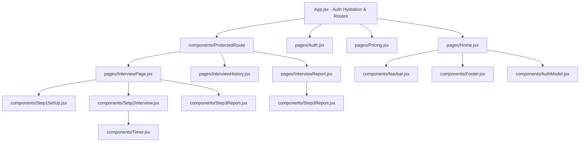
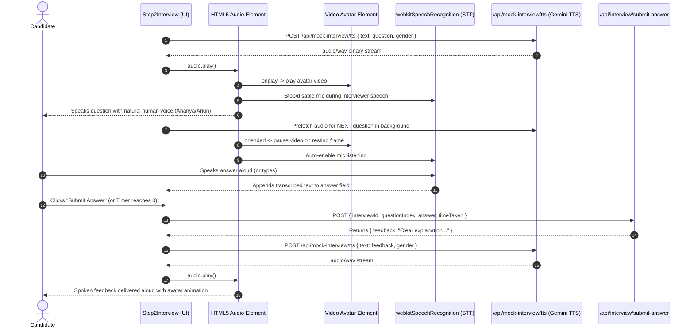
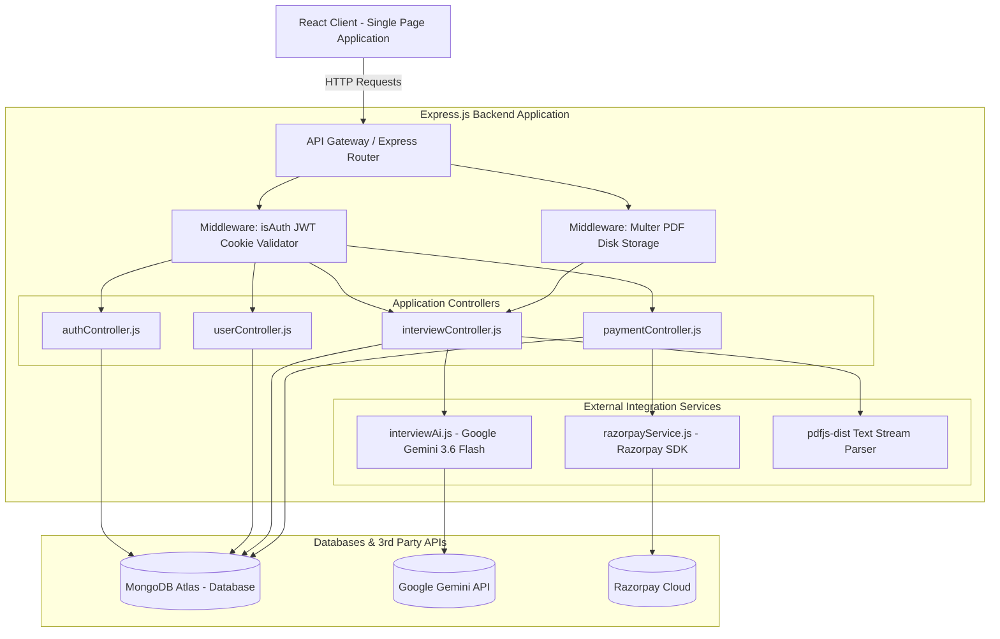
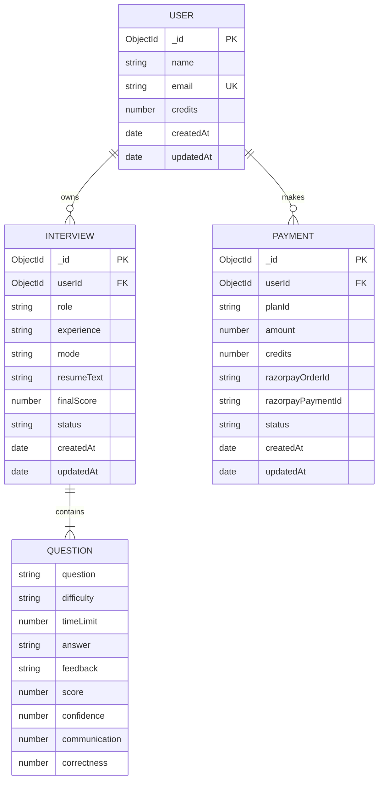

# 🎨 Smart Interview AI (InterviewIQ.AI) — System & UI/UX Design Document

This document outlines the **System Design**, **UI/UX Architecture**, **Component Hierarchy**, **Design System (Tokens, Typography, Colors)**, and **Interactive Media Workflows** of **Smart Interview AI** (branded as **InterviewIQ.AI**).

---

## 📑 Table of Contents
1. [Design Philosophy & Core Pillars](#1-design-philosophy--core-pillars)
2. [Design System & Visual Language](#2-design-system--visual-language)
   - [Color Palette](#color-palette)
   - [Typography Scale](#typography-scale)
   - [Spacing, Radius & Elevation](#spacing-radius--elevation)
   - [Iconography & Media Assets](#iconography--media-assets)
3. [User Experience (UX) Architecture & Screen Wireframes](#3-user-experience-ux-architecture--screen-wireframes)
   - [Screen 1: Landing Page (`/`)](#screen-1-landing-page-)
   - [Screen 2: Authentication Modal / Page (`/auth`)](#screen-2-authentication-modal--page-auth)
   - [Screen 3: Step 1 — Interview Setup & Resume Analyzer](#screen-3-step-1--interview-setup--resume-analyzer)
   - [Screen 4: Step 2 — The AI Interview Chamber](#screen-4-step-2--the-ai-interview-chamber)
   - [Screen 5: Step 3 — Performance Analytics & PDF Report](#screen-5-step-3--performance-analytics--pdf-report)
   - [Screen 6: Interview History Feed (`/history`)](#screen-6-interview-history-feed-history)
   - [Screen 7: Pricing & Credits Checkout (`/pricing`)](#screen-7-pricing--credits-checkout-pricing)
4. [Frontend Component Hierarchy & State Flow](#4-frontend-component-hierarchy--state-flow)
   - [Component Tree](#component-tree)
   - [Redux Global State Architecture](#redux-global-state-architecture)
5. [Voice & Video Interactive Engine (VUI)](#5-voice--video-interactive-engine-vui)
   - [Speech-to-Text (STT) & Gemini Neural TTS Flow](#speech-to-text-stt--gemini-neural-tts-flow)
   - [Avatar Lipsync, Audio Prefetch & State Machine](#avatar-lipsync-audio-prefetch--state-machine)
6. [Backend System Architecture & Data Flow](#6-backend-system-architecture--data-flow)
   - [Layered System Architecture](#layered-system-architecture)
   - [Entity-Relationship Diagram (ERD)](#entity-relationship-diagram-erd)
7. [Responsive Design & Accessibility (a11y)](#7-responsive-design--accessibility-a11y)

---

## 1. Design Philosophy & Core Pillars

Smart Interview AI's user interface is designed to emulate an authentic, calm, and confidence-building interview environment.

* **Psychological Comfort & Minimalism:** Interviews can be intimidating. The UI uses soft mint/emerald greens, off-whites, and rounded surfaces to reduce candidate stress.
* **Multimodal Interaction (VUI + GUI):** Candidates can talk or type; listen or read subtitles; watch the AI avatar or focus on the countdown timer.
* **Immediate Feedback Loop:** Real-time speech transcription, per-question audio/visual feedback, and animated countdown timers keep the user engaged.
* **Information Density with Hierarchy:** Heavy analytics (charts, scores, feedback) are broken into digestible cards, progress rings, and visual tables.

---

## 2. Design System & Visual Language

### Color Palette

The color system centers around an **Emerald / Mint** spectrum paired with clean monochromatic neutrals:

| Role | Tailwind Token | Hex / CSS | Usage |
| :--- | :--- | :--- | :--- |
| **Primary Brand** | `emerald-600` / `green-600` | `#16a34a` / `#059669` | Primary CTAs, active states, score highlights, avatar borders |
| **Primary Light** | `emerald-50` / `green-50` | `#ecfdf5` / `#f0fdf4` | Soft card backgrounds, badges, active step highlights |
| **Primary Accent** | `teal-500` | `#14b8a6` | Gradient accents (`from-emerald-600 to-teal-500`) |
| **App Background** | Gray Light | `#f3f3f3` | Global layout canvas background |
| **Card Surface** | Pure White | `#ffffff` | Floating content panels, modal boxes, dropdowns |
| **Text Primary** | `gray-800` | `#1f2937` | Headings, questions, primary labels |
| **Text Secondary** | `gray-500` / `gray-600` | `#6b7280` / `#4b5563` | Subtitles, body descriptions, timer secondary text |
| **Text Muted** | `gray-400` | `#9ca3af` | Placeholders, question index badges, breadcrumbs |
| **Border / Divider** | `gray-200` | `#e5e7eb` | Structural separators, card borders |
| **Success Status** | `emerald-700` / `bg-emerald-100` | `#047857` / `#d1fae5` | Completed status pills, high score badges (≥8/10) |
| **Warning Status** | `yellow-700` / `bg-yellow-100`| `#a16207` / `#fef9c3` | Incompleted status, mid score badges (5–7/10) |
| **Danger Status** | `red-500` | `#ef4444` | Low score warnings, logout action button |

---

### Typography Scale

System Font Stack: `Inter`, `-apple-system`, `BlinkMacSystemFont`, `Segoe UI`, `Roboto`, `sans-serif`.

| Element | Size | Weight | Line Height | Tailwind Class |
| :--- | :--- | :--- | :--- | :--- |
| **Hero Display** | 48px – 60px | Bold (`700`) | `1.15` | `text-4xl md:text-6xl font-semibold` |
| **Page Title** | 30px – 36px | Bold (`700`) | `1.25` | `text-3xl font-bold` |
| **Section Header**| 24px – 28px | SemiBold (`600`) | `1.3` | `text-2xl font-bold` |
| **Card Header** | 18px – 20px | SemiBold (`600`) | `1.4` | `text-lg font-semibold` |
| **Body Large** | 16px – 18px | Regular (`400`) | `1.6` | `text-lg text-gray-500` |
| **Body Standard**| 14px – 15px | Regular (`400`) | `1.5` | `text-sm text-gray-700` |
| **Captions/Tags** | 12px – 13px | Medium (`500`) | `1.4` | `text-xs font-medium` |

---

### Spacing, Radius & Elevation

* **Border Radii:**
  * Ultra Rounded Cards: `rounded-3xl` (`24px` to `32px`) — used for main container cards, interview split panes, and modal containers.
  * Inputs & Controls: `rounded-xl` (`12px` to `16px`) — used for form inputs, dropdowns, and button controls.
  * Badges & Micro-CTAs: `rounded-full` (`9999px`) — used for pill tags, user avatars, and primary pill buttons.
* **Shadow Hierarchy:**
  * Base Card: `shadow-sm` / `border border-gray-200`
  * Hover / Active: `shadow-xl` / `hover:scale-[1.02]`
  * Floating Modals: `shadow-2xl`
* **Card Rotation Playfulness:**
  * The landing page steps utilize subtle CSS transforms for an inviting, non-rigid feel:
    * Step 1: `rotate-[-4deg]`
    * Step 2: `rotate-[3deg] md:-mt-6 shadow-xl` (Prominent center card)
    * Step 3: `rotate-[-3deg]`

---

### Iconography & Media Assets

* **React Icons Library (`react-icons`):**
  * `BsRobot` — Brand Logo mark
  * `BsCoin` — Credit currency representation
  * `BsMic` / `FaMicrophone` / `FaMicrophoneSlash` — Live audio state control
  * `FaUserTie` / `FaBriefcase` — Role and experience inputs
  * `FaFileUpload` — Resume drag-and-drop trigger
  * `BsClock` — Timer countdown visual indicator
  * `BsBarChart` / `FaChartLine` — Analytics & reporting
* **Video Avatars:**
  * `female-ai.mp4` & `male-ai.mp4` — Looped video clips with conversational demeanor synchronized with the Web Speech API voice gender.

---

## 3. User Experience (UX) Architecture & Screen Wireframes

### Screen 1: Landing Page (`/`)
* **Header / Navbar:** Floating glass card with logo, live credit coin counter pill, and user profile avatar with dropdown.
* **Hero Section:** Centered headline with green pill highlighting `"AI Intelligence"`, dual call-to-actions: `[Start Interview]` & `[View History]`.
* **Step Progression Carousel:** 3 cards demonstrating the 3-step loop (Role Selection ➡️ Voice Interview ➡️ Real-Time Feedback).
* **Feature Grid:** 4-card grid detailing AI Answer Evaluation, Resume-based questions, PDF Export, and Analytics History.
* **Interview Mode Showcase:** Split cards introducing **HR Mode** (behavioral, soft skills) and **Technical Mode** (architecture, coding concepts).

```
┌────────────────────────────────────────────────────────────────────────┐
│ [🤖 InterviewIQ.AI]                             [🪙 1000] [👤 User]   │
│                                                                        │
│               Practice Interviews with [AI Intelligence]               │
│      Role-based mock interviews with adaptive difficulty and timer     │
│                     [ Start Interview ]  [ View History ]              │
│                                                                        │
│       ┌──────────────┐     ┌──────────────┐     ┌──────────────┐       │
│       │ 🤖 STEP 1    │     │ 🎙️ STEP 2    │     │ ⏱️ STEP 3    │       │
│       │ Select Role  │     │ Voice Session│     │ Timer Sim    │       │
│       └──────────────┘     └──────────────┘     └──────────────┘       │
└────────────────────────────────────────────────────────────────────────┘
```

---

### Screen 2: Authentication Modal / Page (`/auth`)
* Minimalist modal card with floating robot emblem.
* Tagline: *"Continue with AI Smart Interview"*.
* Single-click Google OAuth button (`FcGoogle` icon + `"Continue with Google"`).
* Automatic redirect back to origin upon authentication.

---

### Screen 3: Step 1 — Interview Setup & Resume Analyzer
A modern 50/50 split-screen card layout:
* **Left Column (Brand Promise):** Gradient green card detailing interview benefits with benefit icons.
* **Right Column (Form & Upload):**
  * Target Role input field (e.g. *Frontend Developer*).
  * Years of Experience input (e.g. *2 years*).
  * Mode Dropdown: `Technical Interview` vs `HR Interview`.
  * **Interactive Resume Dropzone:**
    * Dashed border container supporting PDF file upload.
    * When uploaded, displays file name and an `[Analyze Resume]` button.
    * Upon completion, renders extracted **Projects** and **Skills** as green pill chips.
  * Primary Action: `[Start Interview]` (validates input and checks credit balance ≥ 50).

---

### Screen 4: Step 2 — The AI Interview Chamber
A focused, distraction-free environment with a 35/65 desktop split view:

```
┌───────────────────────────────────────────────────────────────────────────────┐
│ ◄ LEFT PANE (35% - AI AVATAR & HUD) │ ► RIGHT PANE (65% - WORKSPACE)          │
│ ┌─────────────────────────────────┐ │ ┌─────────────────────────────────────┐ │
│ │ 🎬 AI Video Avatar              │ │ │ 💡 Question 2 of 5                  │ │
│ │ (Plays while AI is speaking)    │ │ │ "What is the difference between     │ │
│ └─────────────────────────────────┘ │ │  state and props in React?"        │ │
│ ┌─────────────────────────────────┐ │ └─────────────────────────────────────┘ │
│ │ 💬 Live AI Subtitles Box        │ │ ┌─────────────────────────────────────┐ │
│ └─────────────────────────────────┘ │ │ 📝 Textarea (Real-time Speech-to-   │ │
│ ┌─────────────────────────────────┐ │ │    Text transcription or typing)    │ │
│ │ ⏱️ Radial Timer Gauge (60s)    │ │ └─────────────────────────────────────┘ │
│ │ 📊 Question 2 / 5               │ │ ┌───────┐ ┌─────────────────────────┐ │
│ └─────────────────────────────────┘ │ │ 🎙️ Mic│ │ [ Submit Answer ]      │ │
│                                     │ │ Toggle│ └─────────────────────────┘ │
│                                     │ └───────┘                             │
│                                     │ [ AI Feedback: "Great concise answer!"] │
│                                     │ [ Next Question ➔ ]                   │
└─────────────────────────────────────┴─────────────────────────────────────────┘
```

* **Left Pane Elements:**
  * **Video Avatar:** Dynamically toggles male/female MP4 video. Loops on play during TTS and pauses on frame 0 when candidate answers.
  * **Subtitle Banner:** High-contrast transcription of AI speech.
  * **Radial Countdown Timer:** Color-coded circular gauge tracking seconds remaining.
* **Right Pane Elements:**
  * **Question Box:** Current question text and difficulty badge.
  * **Response Textarea:** Auto-transcribes candidate voice stream via Web Speech API; fully editable.
  * **Action Controls:** Circular Mic Toggle button + Gradient `[Submit Answer]` button.
  * **Feedback Box:** Appears dynamically upon answer submission with AI evaluation feedback.

---

### Screen 5: Step 3 — Performance Analytics & PDF Report
Accessible at completion of Step 2 or via `/report/:id`:
* **Top Bar:** Back button to History + `[Download PDF]` button.
* **Metric Cards:**
  * **Overall Final Score:** Large circular progress ring (0–10 score converted to percentage).
  * **Readiness Evaluation:** Tailored status message (e.g., *"Ready for job opportunities"*).
  * **3 Core Skill Gauges:** Confidence, Communication, and Correctness scores.
* **Performance Trajectory Chart:** Recharts Area Chart displaying score trends across Questions 1 through 5.
* **Question-by-Question Accordion/Table:** Full audit log showing each question, submitted candidate answer, score, and AI feedback.
* **PDF Export Feature:** Generates a publication-grade A4 PDF formatted with header branding, score box, skills summary, professional recommendation, and tabular question breakdown.

---

### Screen 6: Interview History Feed (`/history`)
* Card-based timeline displaying past mock interviews.
* Each card includes:
  * Role & Experience badge
  * Interview Mode (HR or Technical)
  * Timestamp date
  * Score badge (e.g., `8.2/10`)
  * Completion status pill (`completed` in green, `Incompleted` in yellow)
* Clickable card opens the full analytical report at `/report/:id`.

---

### Screen 7: Pricing & Credits Checkout (`/pricing`)
* 3-tier pricing layout:
  1. **Free Tier:** ₹0 for 100 Credits (Beginner setup).
  2. **Starter Pack:** ₹100 for 150 Credits (Skill improvement).
  3. **Pro Pack ("Best Value" badge):** ₹500 for 650 Credits (Serious interview prep).
* Click triggers backend `POST /api/payment/order` and launches the embedded **Razorpay Checkout Modal**.

---

## 4. Frontend Component Hierarchy & State Flow

### Component Tree



### Redux Global State Architecture

The application state is managed via Redux Toolkit (`userSlice.js`):

```javascript
// State Shape
{
  user: {
    userData: {
      _id: "6740b3f81e39a04a3f124567",
      name: "Jane Doe",
      email: "janedoe@example.com",
      credits: 950,
      createdAt: "2026-11-23T10:00:00.000Z",
      updatedAt: "2026-11-23T10:30:00.000Z"
    }
  }
}
```

* **Action `setUserData(payload)`:** Dispatched on initial app load (`/api/user/current-user`), after Google Auth login, after interview question generation (to deduct 50 credits), and after Razorpay payment verification (to increment credits).

---

## 5. Voice & Video Interactive Engine (VUI)

### Speech-to-Text (STT) & Gemini Neural TTS Flow



### Avatar Lipsync, Audio Prefetch & State Machine

1. **Persona & Voice Selection:**
   - Candidate chooses **Ananya (Female)** or **Arjun (Male)** on setup.
   - Persona configures:
     - Avatar video source: `female-ai.mp4` vs `male-ai.mp4`.
     - TTS voice profile: `Kore` vs `Puck`.
     - Conversational style prompt and persona name.
2. **Zero-Latency Audio Prefetching:**
   - While the user answers question $N$, the frontend triggers `fetchTtsAudio(questions[N + 1].question)` in the background.
   - The returned blob URL is cached in `prefetchCache.current`. When the user clicks "Next Question", playback begins instantly without buffering delay.
3. **Playback Synchronization & Echo Prevention:**
   - `audio.onplay`: Avatar video loops (`videoRef.current.play()`), status badge reflects "AI Speaking", and candidate mic is turned off to prevent audio bleed and false recognition.
   - `audio.onended`: Avatar video freezes at frame 0, status switches to candidate turn, and candidate mic enables automatically.
4. **Resilient Degradation & Live Captions:**
   - Spoken text is rendered in a high-contrast subtitle pill throughout.
   - If TTS is rate-limited (HTTP 429) or offline, the UI provides a *"Voice unavailable. Reading captions."* notice with a **"Retry voice"** button, ensuring the mock interview never halts.

---

## 6. Backend System Architecture & Data Flow

### Layered System Architecture



---

### Entity-Relationship Diagram (ERD)



---

## 7. Responsive Design & Accessibility (a11y)

### Breakpoints & Layout Adapters

* **Desktop (≥ 1024px):**
  * Interview Chamber: Dual-pane split view (35% avatar HUD / 65% workspace).
  * Report Dashboard: 3-column analytics view with side-by-side gauge and performance curve.
  * Setup Screen: 50/50 dual card presentation.
* **Tablet (768px – 1023px):**
  * Grid layouts adapt gracefully to 2-column or stacked vertical flow.
* **Mobile (< 768px):**
  * Interview Chamber stacks vertically: Video avatar at top, response workspace below.
  * Controls remain thumb-friendly with oversized tap targets (`w-12 h-12` minimum touch target for mic toggle).
  * Navbar collapses auxiliary links into a consolidated user profile menu.

### Accessibility Considerations

* **High-Contrast Text:** Dark slate text (`#1f2937`) over off-white (`#ffffff` / `#f3f3f3`) meets WCAG AAA standards for readability.
* **Dual Input Modes:** Candidates who cannot use microphone input or whose browsers do not support `webkitSpeechRecognition` can effortlessly type their responses directly into the textarea.
* **Visual Subtitles:** Candidates with hearing difficulties or noisy environments can read real-time subtitles directly beneath the video avatar.
* **Graceful Degradation:** If Gemini AI encounters network timeouts, clean error notifications are surfaced without breaking the active interview state.

---

*Design Document maintained for the Smart Interview AI (InterviewIQ.AI) ecosystem.*
