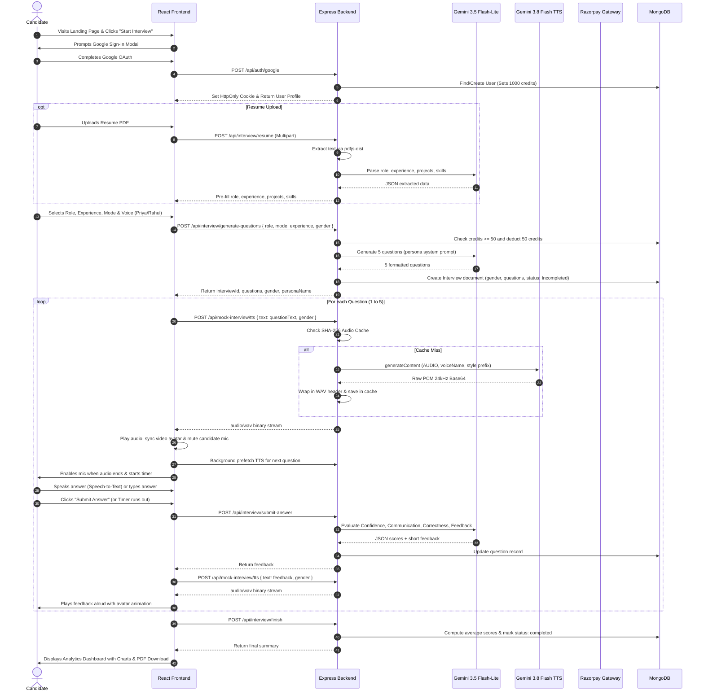

# 🚀 Smart Interview AI (InterviewIQ.AI) — Complete Project Documentation

Welcome to the comprehensive technical and functional documentation for **Smart Interview AI** (branded as **InterviewIQ.AI**). This document provides an in-depth breakdown of the entire platform—its architecture, core features, AI workflows, database structure, and setup instructions—so that any developer, recruiter, or stakeholder can thoroughly understand how the system works.

---

## 📑 Table of Contents
1. [Executive Summary](#-executive-summary)
2. [High-Level Architecture & Tech Stack](#-high-level-architecture--tech-stack)
3. [Core Features & Functional Walkthrough](#-core-features--functional-walkthrough)
   - [1. User Authentication & Authorization](#1-user-authentication--authorization)
   - [2. Resume Parsing & Structured AI Extraction](#2-resume-parsing--structured-ai-extraction)
   - [3. Personalized Interview Setup & Persona Selection](#3-personalized-interview-setup--persona-selection)
   - [4. Interactive AI Interview Simulation & Gemini Neural TTS](#4-interactive-ai-interview-simulation--gemini-neural-tts)
   - [5. Real-Time AI Answer Evaluation & Verbal Feedback](#5-real-time-ai-answer-evaluation--verbal-feedback)
   - [6. Post-Interview Analytics & Downloadable PDF Report](#6-post-interview-analytics--downloadable-pdf-report)
   - [7. Interview History & Tracking](#7-interview-history--tracking)
   - [8. Credit System & Razorpay Monetization](#8-credit-system--razorpay-monetization)
4. [User Journey / End-to-End Workflow](#-user-journey--end-to-end-workflow)
5. [Database Architecture & Data Models](#-database-architecture--data-models)
6. [Folder & Codebase Structure](#-folder--codebase-structure)
7. [Installation & Local Setup Guide](#-installation--local-setup-guide)
8. [Security, Optimization & Audio Caching Architecture](#-security-optimization--audio-caching-architecture)
9. [Future Roadmap & Potential Enhancements](#-future-roadmap--potential-enhancements)

---

## 🌟 Executive Summary

**Smart Interview AI** is an intelligent, full-stack mock interview application built using the **MERN** stack (MongoDB, Express, React, Node.js) and powered by **Google Gemini AI** (`gemini-3.5-flash-lite` for conversational intelligence and `gemini-3.8-flash-tts` for human-like speech synthesis). 

### The Problem It Solves:
Job seekers often struggle with interview anxiety, unstructured answers, poor time management, robotic artificial voices, and a lack of personalized, actionable feedback. Traditional mock interviews are either prohibitively costly or rely on robotic browser speech synthesizers that fail to replicate real interview environments.

### The Solution:
Smart Interview AI delivers a real-world interview simulation that:
- **Speaks like a real human interviewer:** Replaces robotic browser voices with Google's cutting-edge **Gemini Neural TTS** (`gemini-3.8-flash-tts` with `gemini-3.1-flash-tts-preview` fallback). Offers authentic personas—**Priya** (warm senior female interviewer, Kore voice) and **Rahul** (relaxed, confident male interviewer, Puck voice)—with realistic Indian-English conversational pacing, small natural pauses, and conversational fillers.
- **Syncs animated AI video avatars:** Synchronizes male and female video avatars with live audio playback, pausing on neutral frames when candidate responds.
- **Extracts structured resume insights:** Parses experience, projects, and skills directly from the candidate's PDF resume using `pdfjs-dist` and Gemini AI.
- **Generates progressive, role-tailored questions:** Generates 5 progressive questions (Easy ➡️ Medium ➡️ Hard) tailored to candidate's stack, level, and interview mode (Technical vs HR).
- **Enforces realistic time pressure:** Implements countdown pressure timers per question (60s, 90s, 120s) with automated auto-submission.
- **Zero-latency audio prefetching:** Seamlessly prefetches audio for upcoming questions while candidate answers, eliminating waiting time.
- **Evaluates candidate answers in real time:** Evaluates across **Confidence**, **Communication**, and **Correctness** (0-10 scale) with concise human-like spoken feedback.
- **Delivers actionable post-interview analytics:** Visual progress rings, Recharts trajectory graphs, question-by-question breakdown, and one-click downloadable PDF reports.
- **Operates on a credit monetization model:** Integrated with **Razorpay** for credit pack purchases with cryptographic signature verification.

---

## 🏗️ High-Level Architecture & Tech Stack

```
┌────────────────────────────────────────────────────────────────────────┐
│                        CLIENT LAYER (React 19 + Vite)                  │
│  - React Router v7                - Tailwind CSS v4 & Framer Motion    │
│  - Redux Toolkit (User/Auth)      - webkitSpeechRecognition (STT)      │
│  - HTML5 Audio Player (Gemini TTS)- Recharts & CircularProgressbar     │
│  - Background TTS Audio Prefetch  - jsPDF & AutoTable Report Export    │
└─────────────────────────────────┬──────────────────────────────────────┘
                                  │ HTTP / REST APIs (Credentials: include)
                                  ▼
┌────────────────────────────────────────────────────────────────────────┐
│                       SERVER LAYER (Node.js + Express 5)               │
│  - JWT HttpOnly Cookie Auth       - Multer File Upload Handler         │
│  - pdfjs-dist PDF Text Parser     - In-Memory SHA-256 Audio Cache      │
│  - PCM-to-WAV 24kHz Audio Packer  - Crypto HMAC Signature Verifier     │
└──────────────┬──────────────────┬───────────────────┬──────────────────┘
               │                  │                   │
               ▼                  ▼                   ▼
┌──────────────────────┐ ┌─────────────────┐ ┌───────────────────────────┐
│  DATABASE LAYER      │ │  AI ENGINE      │ │  PAYMENT GATEWAY          │
│  - MongoDB Atlas     │ │  - Google GenAI │ │  - Razorpay Orders        │
│  - Mongoose ODM      │ │  - Gemini 3.5   │ │  - Webhooks / HMAC Verify │
│  (Users, Interviews, │ │    Flash-Lite   │ │  (Credit Recharge Packs)  │
│   Payments)          │ │  - Gemini 3.8   │ │                           │
│                      │ │    Flash TTS    │ │                           │
└──────────────────────┘ └─────────────────┘ └───────────────────────────┘
```

### Detailed Tech Stack Breakdown:

| Layer | Technology | Purpose |
| :--- | :--- | :--- |
| **Frontend Framework** | React 19.x + Vite 8.x | Ultra-fast Single Page Application (SPA) development and rendering |
| **Styling & Animation** | Tailwind CSS v4, Motion (Framer Motion) | Modern responsive UI, glassmorphism cards, interactive micro-interactions |
| **State Management** | Redux Toolkit (`@reduxjs/toolkit`) | Global user authentication, profile data, and live credit balance |
| **Routing** | React Router DOM v7 | Client-side routing with route guards (`ProtectedRoute`) |
| **Speech Recognition** | Browser Web Speech API (`webkitSpeechRecognition`) | Real-time candidate voice capture and speech-to-text transcription |
| **Voice Synthesis (TTS)** | Google Gemini Neural TTS API (`@google/genai`) | Studio-quality human voice generation with custom style prompts, WAV packaging, and caching |
| **Visual Charts & PDF** | Recharts, `react-circular-progressbar`, `jspdf`, `jspdf-autotable` | Interactive question analytics charts and professional PDF report generation |
| **Backend Runtime** | Node.js (ES Modules) + Express 5.x | RESTful API server, routing, and controller architecture |
| **Database & ODM** | MongoDB + Mongoose 9.x | Scalable document database for users, interviews, and payments |
| **Authentication** | Firebase Auth (Client) + JWT (Server) | Secure Google OAuth sign-in and HttpOnly cookie session management |
| **File Handling** | Multer + `pdfjs-dist` | In-memory/disk PDF resume upload and binary text stream extraction |
| **Artificial Intelligence** | `@google/genai` (Gemini 3.5 Flash-Lite & Gemini 3.8 Flash TTS) | Resume information extraction, adaptive question generation, 3-pillar evaluation, and audio synthesis |
| **Payment Gateway** | Razorpay Node.js SDK + Razorpay Checkout | In-app credit purchases with cryptographic HMAC-SHA256 signature verification |

---

## ⚡ Core Features & Functional Walkthrough

### 1. User Authentication & Authorization
- **Seamless Google OAuth:** Users sign in with a single click via Firebase Google Authentication popup (`signInWithPopup`).
- **Backend Session Issuance:** Once Google returns the user's name and email, the backend verifies or creates the user in MongoDB.
- **Initial Welcome Credits:** New users are automatically credited with **1000 bonus credits** on first signup.
- **Secure HttpOnly Cookie:** The server creates a signed JWT containing `{ userId }` and sets an `HttpOnly`, `SameSite` cookie (`maxAge`: 7 days), preventing XSS token theft.
- **Persistent App Hydration:** On app boot, `App.jsx` makes a call to `/api/user/current-user` to populate the Redux store with user profile and credit balance.
- **Protected Routes:** Pages like `/interview`, `/history`, and `/report/:id` are protected; unauthenticated visitors are automatically redirected to `/auth`.

---

### 2. Resume Parsing & Structured AI Extraction
- **PDF Upload with Multer:** Candidates can optionally upload their resume in PDF format (up to 5MB).
- **Buffer Stream Extraction:** The backend reads the PDF file with `pdfjs-dist/legacy/build/pdf.mjs`, extracting text from every page while maintaining spatial coherence.
- **Gemini AI Structured Extraction:** Extracted text is fed to Google Gemini AI with strict JSON formatting instructions.
- **Auto-Population:** The AI outputs:
  - Suggested Job Role (e.g. *Full Stack Developer*, *Data Scientist*)
  - Experience Level (e.g. *2 years*, *Fresher*)
  - Key Projects List
  - Technical Skills List
- **Clean Storage & Privacy:** The uploaded PDF is deleted from local storage immediately via `fs.unlinkSync` once text extraction completes.
- **Form Auto-Fill:** The parsed data is returned to the frontend and automatically fills the interview setup fields.

---

### 3. Personalized Interview Setup & Persona Selection
Candidates configure their interview session in Step 1:
- **Target Role:** Custom input (e.g., "React Developer", "DevOps Engineer").
- **Experience Level:** E.g., "Fresher", "2 years", "5+ years".
- **Interview Mode:**
  - **Technical Mode:** Deep technical questions on programming concepts, architecture, performance, and best practices.
  - **HR Mode:** Behavioral questions, conflict resolution, leadership, situational judgment, and workplace culture.
- **Interviewer Voice & Persona Selection:**
  - 👩 **Priya (Female):** Voice `Kore` — warm, conversational, friendly senior interviewer.
  - 👨 **Rahul (Male):** Voice `Puck` — relaxed, confident, conversational interviewer.
  - Persona selection persists across the entire interview session, dictating the video avatar, TTS voice, and system prompt personality.
- **Credit Validation:** System verifies that the user possesses at least **50 credits** before initializing the interview.

---

### 4. Interactive AI Interview Simulation & Gemini Neural TTS
The core interview engine (`Setp2Interview.jsx`) simulates an authentic, high-fidelity interview room:
- **Human Interviewer AI Persona:** Powered by `GEMINI_TEXT_MODEL` (`gemini-3.5-flash-lite`) with a conversational Indian-English prompt:
  - Uses natural fillers (`"okay"`, `"so"`, `"alright"`, `"hmm, interesting"`).
  - Keeps questions concise (15–25 words), one question per turn.
  - Strictly spoken plain text (no markdown, no bullets, no numbering, no robotic phrases like "As an AI").
- **Gemini Neural TTS Engine (`/api/mock-interview/tts`):**
  - Synthesizes speech using `gemini-3.8-flash-tts` (with automatic fallback to `gemini-3.1-flash-tts-preview` on 404/not found).
  - Custom conversational style prompts prefixed to text (e.g., *"Say this warmly and naturally, like a friendly senior interviewer on a call, with a calm, conversational pace:"*).
  - Converts raw 24kHz 16-bit mono PCM into standard WAV headers and streams `audio/wav` to client.
  - **Server-Side SHA-256 Audio Caching:** Audio is cached in memory by hash of `gender:text`, eliminating duplicate API calls and costs for identical questions.
  - **Rate Limit Resilience:** Automatically retries 429 errors after a short backoff before returning `{ error: "TTS_RATE_LIMITED" }`.
- **Zero-Latency Audio Prefetching:**
  - While the candidate answers question *N*, the frontend automatically prefetches the TTS audio for question *N+1* in the background, eliminating waiting delays when moving to the next question.
- **Video Avatar Synchronization:**
  - Plays the corresponding male (`male-ai.mp4`) or female (`female-ai.mp4`) avatar video in loop while audio is actively playing.
  - Automatically pauses video on a neutral resting frame when audio playback finishes.
- **Smart Microphone Auto-Muting:**
  - The candidate's microphone is automatically muted while the AI interviewer speaks, preventing audio feedback loops and accidental speech transcription. Re-activates automatically on audio completion.
- **Captions & Graceful Degradation:**
  - Displays real-time spoken captions and an *"Interviewer is thinking..."* visual state during network generation.
  - If TTS is rate-limited or unavailable, the UI gracefully falls back to captions-only mode with a **"Retry voice"** button, allowing the interview to proceed uninterrupted.
- **5-Question Progressive Difficulty:**
  - **Q1 (Easy) — 60s Time Limit:** Foundational definitions and basic concept explanation.
  - **Q2 (Easy) — 60s Time Limit:** Practical implementation or usage scenario.
  - **Q3 (Medium) — 90s Time Limit:** Problem-solving, architecture, or edge cases.
  - **Q4 (Medium) — 90s Time Limit:** Deep dive into candidate's projects/skills from resume.
  - **Q5 (Hard) — 120s Time Limit:** Advanced scenario, design decision, or high-stakes challenge.

---

### 5. Real-Time AI Answer Evaluation & Verbal Feedback
After submitting each answer:
- **Three Core Pillars of Evaluation (0 to 10 scale):**
  1. **Confidence:** Clarity, assertiveness, tone, and delivery style.
  2. **Communication:** Articulation, conciseness, vocabulary, and sentence structure.
  3. **Correctness:** Technical accuracy, depth, relevance, and completeness.
- **Score Computation:** `finalScore = round(average(Confidence, Communication, Correctness))`.
- **Short Human Feedback:** Gemini AI returns concise 10–15 word feedback mimicking a real interviewer (e.g. *"Clear explanation of diffing algorithm and DOM updates. Good understanding shown."*).
- **Immediate Audio Feedback:** The AI immediately speaks the feedback aloud via Gemini TTS before allowing the user to proceed to the next question.

---

### 6. Post-Interview Analytics & Downloadable PDF Report
When the 5th question is completed, the backend calculates:
- Overall Final Score (out of 10)
- Average Confidence, Communication, and Correctness
- Question-by-Question breakdown table

#### Visual Dashboard:
- **Circular Progress Bar:** Displays percentage readiness and overall score.
- **Performance Rating:**
  - `Score >= 8`: *"Ready for job opportunities. Excellent clarity and structured responses."*
  - `Score >= 5`: *"Needs minor improvement before interviews. Good foundation, refine articulation."*
  - `Score < 5`: *"Significant improvement required. Work on clarity and confidence."*
- **Recharts Area Chart:** Visual trajectory mapping question-by-question performance across the interview.
- **Individual Skill Bars:** Visual metrics for Confidence, Communication, and Technical Accuracy.
- **One-Click PDF Export:** Powered by `jspdf` and `jspdf-autotable`. Produces an A4 document with styled branding, final score summary, skill breakdown, professional advice, and a question-feedback table.

---

### 7. Interview History & Tracking
- Located at `/history`.
- Displays all past interviews taken by the candidate.
- Summarizes role, experience level, mode (HR/Technical), date, completion status, and overall score badge.
- Clicking any past interview card opens its detailed report (`/report/:id`) with historical metrics and PDF download capability.

---

### 8. Credit System & Razorpay Monetization
- **Credit Economics:**
  - New User Bonus: **1,000 Credits**
  - Cost per Interview Session: **50 Credits**
- **Pricing Packages (`/pricing`):**
  - **Free:** ₹0 (100 Credits) — For beginners starting practice.
  - **Starter Pack:** ₹100 (150 Credits) — For focused skill practice.
  - **Pro Pack:** ₹500 (650 Credits) — Best value for serious job hunters.
- **Razorpay Integration Flow:**
  1. Client requests an order via `POST /api/payment/order`.
  2. Server generates a Razorpay Order and stores a `Payment` document in MongoDB with status `"created"`.
  3. Razorpay checkout modal opens on the client.
  4. On successful checkout, the client receives `razorpay_order_id`, `razorpay_payment_id`, and `razorpay_signature`.
  5. The client submits credentials to `POST /api/payment/verify`.
  6. Backend creates an HMAC-SHA256 hash using `RAZORPAY_KEY_SECRET` and compares it with `razorpay_signature`.
  7. If verified, the payment is marked `"paid"` and the user's credits are incremented atomically via `$inc`.

---

## 🔄 User Journey / End-to-End Workflow



---

## 🗄️ Database Architecture & Data Models

### 1. `User` Model (`server/models/userModel.js`)
Stores authenticated candidate profiles and their current credit balance.

| Field | Type | Required | Default | Description |
| :--- | :--- | :---: | :---: | :--- |
| `name` | `String` | Yes | — | Candidate full name from Google OAuth |
| `email` | `String` | Yes | — | Unique user email address (indexed) |
| `credits` | `Number` | No | `1000` | Current available credits balance |
| `createdAt` | `Date` | Auto | Now | Account creation timestamp |
| `updatedAt` | `Date` | Auto | Now | Last update timestamp |

---

### 2. `Interview` Model (`server/models/interviewModel.js`)
Stores complete details of every mock interview session including voice persona and performance metrics.

| Field | Type | Required | Default | Description |
| :--- | :--- | :---: | :---: | :--- |
| `userId` | `ObjectId` (ref: `User`) | Yes | — | Reference to candidate who took interview |
| `role` | `String` | Yes | — | Target job role (e.g. *Frontend Developer*) |
| `experience` | `String` | Yes | — | Experience duration (e.g. *2 years*) |
| `mode` | `String` | Yes | — | Enum: `["HR", "Technical"]` |
| `gender` | `String` | No | `"female"` | Enum: `["male", "female"]` — Selected voice persona |
| `resumeText` | `String` | No | `""` | Raw parsed text extracted from uploaded resume |
| `finalScore` | `Number` | No | `0` | Aggregated overall interview score (0 to 10) |
| `status` | `String` | No | `"Incompleted"` | Enum: `["Incompleted", "completed"]` |
| `questions` | `[QuestionSubSchema]` | No | `[]` | Array of 5 question subdocuments (see below) |
| `createdAt` | `Date` | Auto | Now | Session creation timestamp |
| `updatedAt` | `Date` | Auto | Now | Session completion timestamp |

#### Embedded `QuestionSubSchema`:
| Subfield | Type | Description |
| :--- | :--- | :--- |
| `question` | `String` | The interview question text |
| `difficulty` | `String` | `"easy"`, `"medium"`, or `"hard"` |
| `timeLimit` | `Number` | Allowed answer time in seconds (`60`, `90`, or `120`) |
| `answer` | `String` | Candidate's submitted answer text |
| `feedback` | `String` | AI human interviewer feedback (10–15 words) |
| `score` | `Number` | Overall score for this question (0 to 10) |
| `confidence` | `Number` | Delivery and confidence rating (0 to 10) |
| `communication` | `Number` | Articulation and clarity rating (0 to 10) |
| `correctness` | `Number` | Technical and conceptual accuracy rating (0 to 10) |

---

### 3. `Payment` Model (`server/models/paymentModel.js`)
Maintains an audit log of credit purchases and Razorpay transaction states.

| Field | Type | Required | Default | Description |
| :--- | :--- | :---: | :---: | :--- |
| `userId` | `ObjectId` (ref: `User`) | Yes | — | User who placed the order |
| `planId` | `String` | No | — | Package ID (`"free"`, `"basic"`, `"pro"`) |
| `amount` | `Number` | No | — | Payment amount in INR (e.g., `100`, `500`) |
| `credits` | `Number` | No | — | Credits to be awarded upon verification |
| `razorpayOrderId` | `String` | No | — | Unique order ID issued by Razorpay (`order_xxx`) |
| `razorpayPaymentId`| `String` | No | — | Unique payment ID issued on success (`pay_xxx`) |
| `status` | `String` | No | `"created"` | Enum: `["created", "paid", "failed"]` |
| `createdAt` | `Date` | Auto | Now | Order creation timestamp |
| `updatedAt` | `Date` | Auto | Now | Payment settlement timestamp |

---

## 📁 Folder & Codebase Structure

```
smart-interview-AI/
├── API_DOCUMENTATION.md          # Complete API reference including Gemini TTS
├── PROJECT_DOCUMENTATION.md      # Full architecture, feature, and audio documentation
├── DESIGN.md                     # System design, UI/UX tokens, and VUI design
├── README.md                     # Quick overview and project highlights
│
├── server/                       # Backend Node.js + Express Server
│   ├── config/
│   │   ├── connectDb.js          # MongoDB Mongoose connection handler
│   │   ├── token.js              # JWT generator function
│   │   └── ttsConfig.js          # Voice mapping (Kore/Puck) & style prefixes
│   ├── controllers/
│   │   ├── authController.js     # Google login, logout handlers
│   │   ├── userController.js     # Current user profile retrieval
│   │   ├── interviewController.js# Resume parse, question gen, answer eval, report
│   │   ├── ttsController.js      # /api/mock-interview/tts handler with validation
│   │   └── paymentController.js  # Razorpay order creation & signature verification
│   ├── middlewares/
│   │   ├── isAuth.js             # JWT cookie verification middleware
│   │   └── multer.js             # Disk storage & 5MB file upload filter
│   ├── models/
│   │   ├── userModel.js          # User schema
│   │   ├── interviewModel.js     # Interview schema (with gender & questions)
│   │   └── paymentModel.js       # Razorpay payment schema
│   ├── routes/
│   │   ├── authRoute.js          # /api/auth routes
│   │   ├── userRoute.js          # /api/user routes
│   │   ├── interviewRouter.js    # /api/interview routes
│   │   ├── mockInterviewRoute.js # /api/mock-interview/tts route
│   │   └── paymentRoute.js       # /api/payment routes
│   ├── services/
│   │   ├── interviewAi.js        # Google Gemini AI text generation
│   │   ├── ttsService.js         # Gemini TTS synthesis, PCM-to-WAV, cache, fallback
│   │   └── razorpayService.js    # Razorpay SDK initialization
│   ├── test-tts.bat              # Windows smoke-test script for TTS endpoint
│   ├── test-tts.sh               # Bash smoke-test script for TTS endpoint
│   ├── public/                   # Temporary upload directory and static bundle
│   ├── index.js                  # Server entry point, CORS, routes mounting
│   ├── package.json              # Server dependencies (@google/genai, express, etc.)
│   ├── .env                      # Server environment secrets
│   └── .env.example              # Environment variable template
│
└── client/                       # Frontend React + Vite Application
    ├── public/                   # Static icons and assets
    ├── src/
    │   ├── assets/
    │   │   ├── videos/
    │   │   │   ├── female-ai.mp4 # Video avatar for Priya (female voice)
    │   │   │   └── male-ai.mp4   # Video avatar for Rahul (male voice)
    │   │   └── *.png             # Feature illustrations and mode badges
    │   ├── components/
    │   │   ├── Navbar.jsx        # Navigation bar, credit counter, user dropdown
    │   │   ├── Footer.jsx        # Application footer
    │   │   ├── AuthModel.jsx     # Google sign-in popup dialog
    │   │   ├── Step1SetUp.jsx    # Role setup, resume uploader, Priya/Rahul selector
    │   │   ├── Setp2Interview.jsx# Main interview chamber with Gemini TTS & audio player
    │   │   ├── Step3Report.jsx   # Analytics dashboard, Recharts graph, PDF generator
    │   │   └── Timer.jsx         # Circular animated question countdown timer
    │   ├── pages/
    │   │   ├── Home.jsx          # Landing page with feature highlights and CTA
    │   │   ├── Auth.jsx          # Dedicated sign-in page
    │   │   ├── InterviewPage.jsx # Multi-step interview container (Step 1 -> 2 -> 3)
    │   │   ├── interviewHistory.jsx # Past interview records listing
    │   │   ├── InterviewReport.jsx  # Detailed past report viewer (/report/:id)
    │   │   └── Pricing.jsx       # Razorpay credit purchase packages
    │   ├── redux/
    │   │   ├── store.js          # Redux Toolkit store configuration
    │   │   └── userSlice.js      # Global state for userData & credits
    │   ├── utils/
    │   │   └── firebase.js       # Firebase client config & GoogleAuthProvider
    │   ├── App.jsx               # Route definitions, session hydration, route guards
    │   ├── main.jsx              # App entry point with Redux Provider & BrowserRouter
    │   └── index.css             # Tailwind CSS imports
    ├── vite.config.js            # Vite build configuration
    ├── package.json              # Client dependencies
    ├── .env                      # Client environment variables
    └── .env.example              # Client env template
```

---

## 💻 Installation & Local Setup Guide

### 1. Prerequisites
- **Node.js**: Recommended v20.x or v22.x LTS ([Download](https://nodejs.org))
- **Browser**: **Google Chrome** or **Microsoft Edge** (required for `webkitSpeechRecognition` microphone input)
- **MongoDB**: A free MongoDB Atlas cluster connection URI or local MongoDB instance
- **Google AI Studio Key**: API key with Gemini access ([Get Key](https://aistudio.google.com/))

---

### 2. Clone and Install Dependencies

```bash
# 1. Clone repository
git clone <repository_url>
cd smart-interview-AI

# 2. Install backend dependencies
cd server
npm install

# 3. Install frontend dependencies
cd ../client
npm install
```

---

### 3. Configure Environment Variables

#### Backend Environment File (`server/.env`):
Create or edit `.env` inside the `server/` directory:
```env
PORT=3000
MONGO_URI=mongodb+srv://<username>:<password>@cluster0.xxxxx.mongodb.net/smart-interview?retryWrites=true&w=majority
JWT_SECRET=your_jwt_secret_here
GEMINI_API_KEY=your_gemini_api_key_here
GEMINI_TEXT_MODEL=gemini-3.5-flash-lite
GEMINI_TTS_MODEL=gemini-3.8-flash-tts
GEMINI_TTS_FALLBACK_MODEL=gemini-3.1-flash-tts-preview
RAZORPAY_KEY_ID=rzp_test_...
RAZORPAY_KEY_SECRET=...your_razorpay_secret...
```

#### Frontend Environment File (`client/.env`):
```env
VITE_FIREBASE_API_KEY=AIzaSy...your_firebase_api_key...
VITE_BACKEND_URL=http://localhost:3000
VITE_RAZORPAY_KEY_ID=rzp_test_...your_razorpay_key_id...
```

---

### 4. Running the Application Locally

You will need two active terminal windows:

#### Terminal 1 — Start the Backend Server:
```bash
cd server
npm run dev
```
*Expected output:*
```
Server is running on port 3000
Connected to MongoDB successfully
```

#### Terminal 2 — Start the Frontend Client:
```bash
cd client
npm run dev
```
*Expected output:*
```
  VITE v8.0.1  ready in 240 ms

  ➜  Local:   http://localhost:5173/
  ➜  Network: use --host to expose
```

Now open **http://localhost:5173** in **Google Chrome**.

---

### 5. Testing the Gemini TTS Endpoint

You can smoke-test the voice synthesis endpoint directly:

#### On Windows:
```cmd
cd server
test-tts.bat <YOUR_JWT_COOKIE_VALUE>
```

#### On Linux / macOS:
```bash
cd server
chmod +x test-tts.sh
./test-tts.sh <YOUR_JWT_COOKIE_VALUE>
```

Verify that `test-female.wav` and `test-male.wav` are generated and play natural speech.

---

## 🛡️ Security, Optimization & Audio Caching Architecture

1. **HttpOnly Cookie Architecture:** JWTs are never stored in localStorage, eliminating vulnerability to Cross-Site Scripting (XSS) credential theft.
2. **SHA-256 In-Memory Audio Caching:** Synthesized voice responses are hashed by `hash(gender + ":" + text)` and stored in an in-memory cache. Identical questions across candidates are served instantly with zero Gemini API audio cost.
3. **Automatic Fallback & Model Resilience:** If the primary TTS model (`gemini-3.8-flash-tts`) returns 404 or model not found, the service seamlessly retries with the preview fallback (`gemini-3.1-flash-tts-preview`).
4. **Rate Limit Exponential Backoff:** Rate-limited calls (HTTP 429) back off and retry once before safely returning a structured `{ error: "TTS_RATE_LIMITED" }` error code.
5. **Background Audio Prefetching:** The frontend prefetches the next question's TTS audio while the candidate speaks, eliminating perceived network latency between questions.
6. **Smart Echo Cancellation / Mic Muting:** The candidate's microphone is muted during interviewer speech playback to prevent feedback and false transcriptions.
7. **Automated Resource Cleanup:** Resumes uploaded for parsing are unlinked and erased from the filesystem immediately after parsing, ensuring no sensitive candidate files linger on disk.
8. **Cryptographic Payment Verification:** Razorpay payments use server-side `crypto.createHmac("sha256", secret)` checks before any user credits are modified.

---

## 🔮 Future Roadmap & Potential Enhancements

- 📹 **Computer Vision Emotion & Eye Contact Tracking:** Integrate FaceMesh or MediaPipe to provide visual engagement analytics.
- 💻 **Interactive Live Code Editor:** Embed Monaco Editor for real-time coding evaluations during Technical mode interviews.
- 🌐 **Multilingual Voice Support:** Expand the voice interviewer to support Hindi, Spanish, German, and other languages using Gemini multilingual TTS.
- 🧑‍💼 **Recruiter & Corporate Dashboard:** Allow enterprise recruiters to create custom job descriptions, invite candidates, and view proctored interview scorecards.
- 📱 **Mobile Native Application:** Build Flutter or React Native apps for on-the-go interview practice.

---

*Authored and maintained for the Smart Interview AI (InterviewIQ.AI) Project.*
